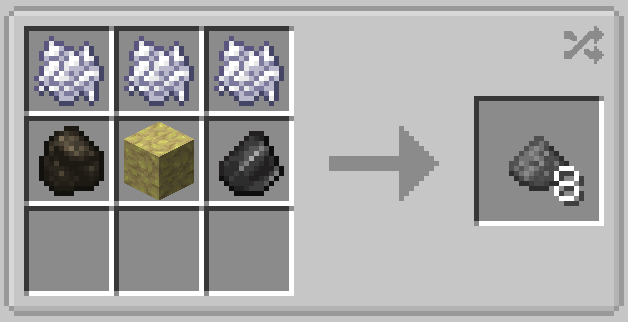
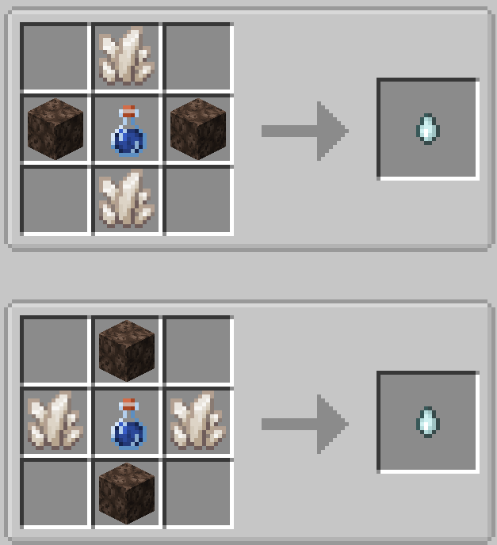
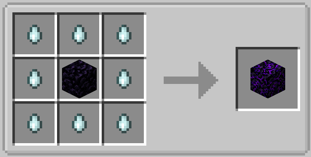
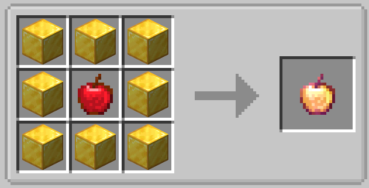
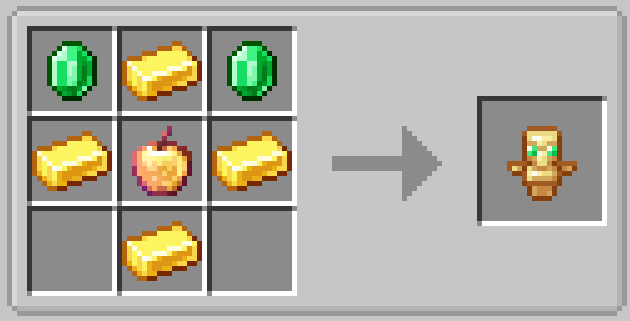
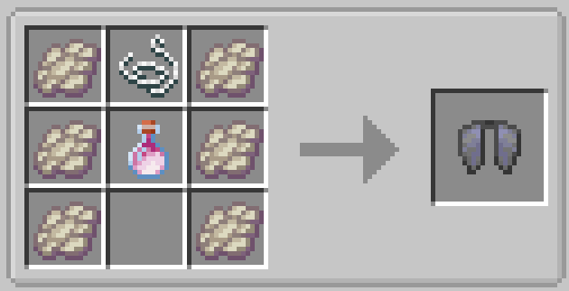

<div align="center">


# ReciPrime

**From Vanilla to Prime.**

[](https://github.com/zzong-mee/ReciPrime/releases/latest)
[](https://github.com/zzong-mee/ReciPrime/actions/workflows/build.yml)
[](LICENSE)
[](https://github.com/zzong-mee/ReciPrime/releases)

**English** · [한국어](README.ko.md)

[Download latest release](https://github.com/zzong-mee/ReciPrime/releases/latest) · [Changelog](CHANGELOG.md) · [Report an issue](https://github.com/zzong-mee/ReciPrime/issues)

</div>

## About

**ReciPrime** is a vanilla-friendly Fabric mod for Minecraft Java Edition **26.3** that introduces alternative crafting recipes and new ways to obtain resources.

Designed to expand crafting possibilities while preserving the balance and spirit of vanilla Minecraft, ReciPrime offers new approaches to familiar items without changing the core survival experience.

The name ReciPrime combines **Recipe** with the mathematical prime symbol (′), representing new possibilities derived from existing recipes.

## Features

- Alternative crafting recipes using only vanilla Minecraft items.
- No custom items or dedicated creative inventory tabs.
- Recipe book unlocks for all added recipes.
- Crafting table and Crafter support.
- Glass bottle returns for Ghast Tear and Elytra crafting.
- Existing vanilla recipes and resource drops are preserved.

## Crafting recipes

| Item | Output | Recipe type |
|---|---:|---|
| Gunpowder | 8 | Shapeless |
| Ghast Tear | 1 | Shaped (two orientations) |
| Crying Obsidian | 1 | Shaped |
| Enchanted Golden Apple | 1 | Shaped |
| Totem of Undying | 1 | Shaped |
| Elytra | 1 | Shaped |

Seven crafting recipes are available for six vanilla items.

### Recipe previews

<table>
  <tr>
    <td width="50%" align="center" valign="top">
      <b>Gunpowder</b><br>
      
    </td>
    <td width="50%" align="center" valign="top">
      <b>Ghast Tear</b><br>
      
    </td>
  </tr>
  <tr>
    <td align="center" valign="top">
      <b>Crying Obsidian</b><br>
      
    </td>
    <td align="center" valign="top">
      <b>Enchanted Golden Apple</b><br>
      
    </td>
  </tr>
  <tr>
    <td align="center" valign="top">
      <b>Totem of Undying</b><br>
      
    </td>
    <td align="center" valign="top">
      <b>Elytra</b><br>
      
    </td>
  </tr>
</table>

## Compatibility

> **Breaking changes:** The mod ID has changed from `sulfur_gunpowder` to `reciprime`. Previous custom items have been removed, and automatic migration is not provided. Back up existing worlds before upgrading.

Single-player functionality has been tested. Dedicated server and multiplayer compatibility have not been verified for v1.1.0.

## Requirements

| Component | Version |
|---|---|
| Minecraft Java Edition | **26.3** |
| Fabric Loader | **0.19.5 or newer** |
| Fabric API | **0.166.2+26.3** (version used to build the mod) |
| Java | **25 or newer** |
| Installation | **Both server and client** |

## Installation

1. Install a compatible **Fabric Loader** for Minecraft 26.3.
2. Install **Fabric API**.
3. Download `ReciPrime-1.1.0.jar` from [GitHub Releases](https://github.com/zzong-mee/ReciPrime/releases).
4. Put the mod JAR and Fabric API in the `mods` directory **on both the client and server**.
5. Start Minecraft or the dedicated server with Fabric.

Download the regular mod JAR, **not** the `-sources.jar` source archive.

## Build from source

A Java 25 development environment is required.

```bash
# macOS / Linux
./gradlew build
```

```bat
REM Windows
gradlew.bat build
```

The compiled mod JAR is written to `build/libs/`.

## Releases and history

- **v1.0.0** is the first stable release, published under the former Sulfur Gunpowder name.
- **v1.1.0** introduces the ReciPrime identity and vanilla-only crafting recipes.
- Previous releases and their changes are documented in [CHANGELOG.md](CHANGELOG.md).
- View downloadable versions on the [Releases page](https://github.com/zzong-mee/ReciPrime/releases).

## License

This project includes a [CC0 1.0 Universal license](LICENSE).

---
<div align="center">

Made for the Minecraft Fabric community.

</div>
