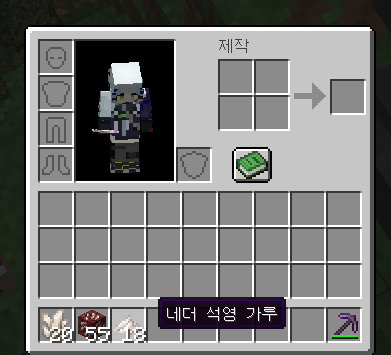
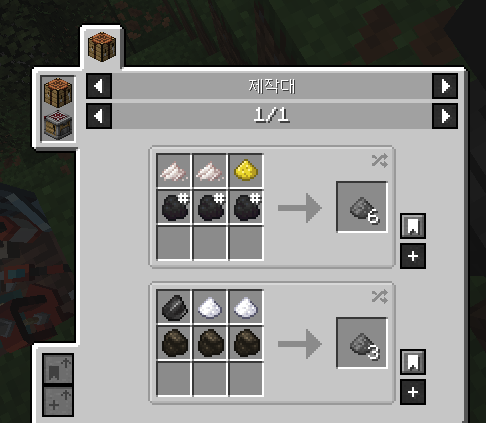

<div align="center">


# ReciPrime

**More Recipes, More Possibilities.**

[](https://github.com/zzong-mee/ReciPrime/releases/latest)
[](https://github.com/zzong-mee/ReciPrime/actions/workflows/build.yml)
[](LICENSE)
[](https://github.com/zzong-mee/ReciPrime/releases)

**English** · [한국어](README.ko.md)

[Download latest release](https://github.com/zzong-mee/ReciPrime/releases/latest) · [Changelog](CHANGELOG.md) · [Report an issue](https://github.com/zzong-mee/ReciPrime/issues)

</div>

## About

**ReciPrime** (formerly Sulfur Gunpowder) is a Fabric mod for Minecraft Java Edition **26.3** that adds an alternative way to obtain vanilla gunpowder. Gather resources through mining and exploration, process sulfur, and craft gunpowder without replacing the vanilla survival experience.

## Features

- **Sulfur Powder:** A new resource obtained by unpacking vanilla sulfur blocks.
- **Nether Quartz Powder:** A new powder item connected to Nether quartz ore mining rewards.
- **Alternative gunpowder recipe:** Craft vanilla gunpowder using a shapeless crafting recipe.
- **Mining integration:** Nether quartz ore rewards support Fortune, while Silk Touch is excluded from the additional powder drop.
- **Creative inventory:** A dedicated ReciPrime tab.
- **Localization:** English and Korean item names and text.
- **Vanilla-style art:** Custom 16×16 item textures.

## In-game previews

| Nether Quartz Powder | Gunpowder crafting |
|:--:|:--:|
|  |  |

## Requirements

| Component | Version |
|---|---|
| Minecraft Java Edition | **26.3** |
| Fabric Loader | **0.19.5 or newer** |
| Fabric API | **0.166.2+26.3** (version used to build the mod) |
| Java | **25 or newer** |
| Installation | **Both server and client** |

## Installation

1. Install a compatible **Fabric Loader** for Minecraft 26.3.
2. Install **Fabric API**.
3. For the existing v1.0.0 release, download `sulfur_gunpowder-1.0.0.jar` from [GitHub Releases](https://github.com/zzong-mee/ReciPrime/releases/tag/v1.0.0).
4. Put the mod JAR and Fabric API in the `mods` directory **on both the client and server**.
5. Start Minecraft or the dedicated server with Fabric.

Download the regular mod JAR, **not** the `-sources.jar` source archive.

## Build from source

A Java 25 development environment is required.

```bash
# macOS / Linux
./gradlew build
```

```bat
REM Windows
gradlew.bat build
```

The compiled mod JAR is written to `build/libs/`.

## Releases and history

- **v1.0.0** is the first stable release, published under the former Sulfur Gunpowder name.
- **v1.1.0** is in development and introduces the ReciPrime identity.
- Previous releases and their changes are documented in [CHANGELOG.md](CHANGELOG.md).
- View downloadable versions on the [Releases page](https://github.com/zzong-mee/ReciPrime/releases).

## License

This project includes a [CC0 1.0 Universal license](LICENSE).

---
<div align="center">

Made for the Minecraft Fabric community.

</div>
